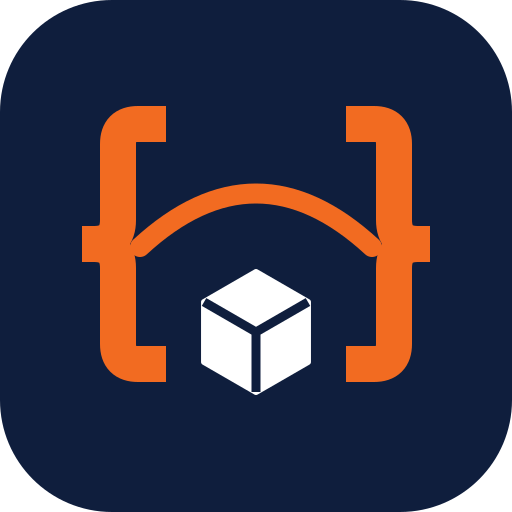
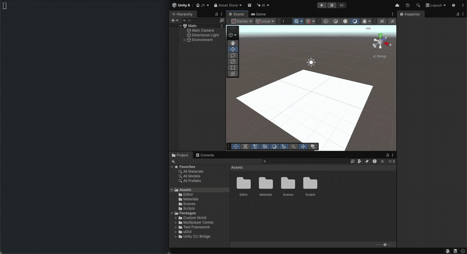

<p align="center">
  
</p>

<h1 align="center">unity-cli-bridge</h1>

**unity-cli-bridge** is a command-line interface for the Unity Editor: declarative commands for scenes, prefabs, materials, assets, packages, the Test Runner, Play Mode QA, and profiling, each returning JSON on stdout.

> **Maintenance:** personal side project, maintained on a best-effort basis in my spare time. See [Maintenance](#maintenance).

It is for developers who script the Editor and for AI coding agents such as Claude Code, Codex, and Grok Build. An agent skill ships with the repo. The bridge runs on Unity 2021.3 LTS or later, including Unity 6. Published CLI builds are macOS Apple Silicon and Windows x64.



CLI v0.5.6: `status`, `scene add-object`, `scene assign-material`, `scene add-component`, `play`, `read-console --type error`, `stop`.

## Requirements

- **Unity:** 2021.3 LTS or newer, including Unity 6. Checked on 2021.3.45f2, the latest public 2021.3 patch. Later 2021.3 releases are paid extended-LTS builds. Gradient property edits require Unity 2022.1 or newer; older editors return `UNSUPPORTED_PROPERTY`.
- **Published CLI builds:** macOS Apple Silicon (`unity-cli-osx-arm64.tar.gz`) and Windows x64 (`unity-cli-win-x64.zip`). No Intel Mac build is published. No Linux build is published.
- **Running Editor:** commands that query or change a project need an Editor with this package loaded. The bridge starts when that Editor opens. `editor launch` can start one, including headless (`-batchmode`, GPU left available).
- **Installed with the package:** `com.unity.test-framework` 1.4.5 (declared in `package.json`).
- **Optional — Unity Recorder** (`com.unity.recorder` 3.0.0 or newer): required for `record` and `qa run-sequence --record`. Without it, `record start` returns an install hint and the other commands still work. On Unity 6000.4 and newer, Recorder 5.1.6 or later is required or Recorder itself does not compile.
- **Optional — Input System** (`com.unity.inputsystem`): pointer QA works without it. On the legacy Input Manager, coordinate `qa tap` with no UI hit, the `qa tap --target` world fallback, coordinate `qa swipe`, and the matching `qa run-sequence` actions send a simulated touch that Unity also reports as left mouse button 0. `qa key` is delivered to `IQaKeyHandler` components and otherwise returns `QA_LEGACY_KEY_UNSUPPORTED`. `--button right` returns `QA_LEGACY_BUTTON_UNSUPPORTED`.
- **Optional — Memory Profiler** (`com.unity.memoryprofiler`): required only for `profile memory snapshot`. The other `profile` commands do not use it.

## Design Philosophy

Most Editor automation falls into two camps:

**A server in the middle** wraps dozens of actions behind a Python or Node process. Every call hops through that process before it reaches the Editor. More moving parts, more failure modes.

**Dynamic code execution** sends raw C# to Unity and reads results from Debug.Log. Infinitely flexible, but the caller must generate correct C# every time, and reading results requires a second call.

**unity-cli-bridge takes a third path: declarative commands over direct IPC.**

```
CLI ──── local IPC ──── Unity Editor (bridge)
         (Named Pipe on Windows, Unix socket on macOS)
```

- **One hop, no intermediary.** The CLI talks directly to the Editor over local IPC.
- **Declarative, not imperative.** `scene add-object --primitive Cube --position 3,0,0` instead of writing C# code. The caller picks options, not APIs.
- **Token-aware responses.** `--output compact` strips envelope metadata. `--omit-defaults` strips default and identity values from inspect and material responses.
- **Structured results in stdout.** No polling, no log scraping, no file reads. Every command returns JSON immediately.
- **Fail fast, fail loud.** Invalid options get a clear error. Unrecognized patch keys return warnings instead of silent success.

## Quick Start

Unity version, CLI platforms, and optional packages are in [Requirements](#requirements).

### 1. Add the Unity Package

Add the package in either of these ways.

**Option A: .unitypackage**

Download `com.yhc509.unity-cli-bridge-0.6.0.unitypackage` from the [itch page](https://yhkk.itch.io/unity-cli-bridge) or the [v0.6.0 GitHub Release](https://github.com/yhc509/unity-cli-bridge/releases/tag/v0.6.0). In Unity, choose **Assets > Import Package > Custom Package…**. It imports as a package under `Packages/com.yhc509.unity-cli-bridge/`. From 0.5.6 on, each GitHub Release attaches `com.yhc509.unity-cli-bridge-<version>.unitypackage`.

**Option B: Git URL** (easier to update)

In Package Manager, choose **Add package from git URL** and paste:

```
https://github.com/yhc509/unity-cli-bridge.git?path=/unity-package/com.yhc509.unity-cli-bridge#v0.6.0
```

Use `#main` instead of `#v0.6.0` to track the latest release. To reproduce a pinned build later, keep the release tag and commit `Packages/packages-lock.json`.

The same URL can be written into `Packages/manifest.json`:

```json
{
  "dependencies": {
    "com.yhc509.unity-cli-bridge": "https://github.com/yhc509/unity-cli-bridge.git?path=/unity-package/com.yhc509.unity-cli-bridge#v0.6.0"
  }
}
```

The bridge starts automatically when the Editor opens. No configuration needed.

Unity Recorder is optional and is not installed for you. Add `com.unity.recorder` 3.0.0 or newer if you want the `record` commands or `qa run-sequence --record`; without it those commands fail with an install hint and everything else works normally.

> **Upgrading from 0.3.x?** `0.4.0` bumps the wire protocol to `5`, so a `0.3.x` CLI cannot talk to a `0.4.0` package. From `0.4.1` on you no longer have to choose: install the CLI from each project's **Window > Unity CLI Manager**, and the `unity-cli` on your PATH hands off to the version that matches whichever project you are pointing at.

### 2. Install the CLI

**From the Editor** (recommended)

Open **Window > Unity CLI Manager** and click **Install CLI**. It downloads the CLI that matches this project's package version from GitHub Releases and installs it under `~/.unity-cli-bridge/`. Add `~/.unity-cli-bridge/unity-cli/` to your PATH. The **PATH Setup** section has a **Copy PATH command** button.

The install is versioned. `~/.unity-cli-bridge/unity-cli/` stays the directory on your PATH:

```
~/.unity-cli-bridge/
  unity-cli/
    unity-cli          # PATH target -> newest installed version
  versions/
    0.3.5/unity-cli    # protocol 4
    0.4.1/unity-cli    # protocol 5
```

**Projects can sit on different package versions.** Run **Install CLI** once from each project's CLI Manager. When a command reaches a bridge that speaks an older protocol, the CLI re-runs itself as the matching version — same `unity-cli` command, no flags, nothing to configure. If no installed version speaks that protocol, the command fails with `PROTOCOL_MISMATCH` and tells you to run **Install CLI** in that project.

Old versions are never deleted automatically (each binary is ~78 MB). The CLI Manager lists what is installed and gives each version a **Remove** button.

> **Heads-up when upgrading:** a project still on package `0.4.0` or earlier has the old CLI Manager, which installs a single flat binary over `~/.unity-cli-bridge/unity-cli/` and clobbers the dispatcher. To recover, open **Window > Unity CLI Manager** in any project on `0.4.1`+ and click **Install CLI** — it restores the PATH target and files away the flat binary it found.
>
> **What happens to that flat binary.** If a previous CLI Manager installed it, its version is on record: it is filed under `versions/<version>/` and stays available for hand-off — which is how a project still on `0.3.x` keeps working without any change of its own. If it was downloaded by hand (the manual download below), there is no version on record and nothing in the binary reports one, so its wire protocol is unknown and it cannot be a hand-off candidate. It is **not deleted** — it is moved to `~/.unity-cli-bridge/orphaned/` and listed in the CLI Manager under **Unidentified Binaries**, so you can still get at it or remove it yourself.
>
> Either way, the old Manager cannot install a versioned CLI for its own project. If a `0.3.x` project ends up with no CLI that speaks its protocol, upgrade that project's package to `0.4.1`+ and install from its own CLI Manager.

**Manual download**

A CLI archive is the alternative. Download it from the [itch page](https://yhkk.itch.io/unity-cli-bridge) or [GitHub Releases](https://github.com/yhc509/unity-cli-bridge/releases):

| Platform | File |
|----------|------|
| macOS (Apple Silicon) | `unity-cli-osx-arm64.tar.gz` |
| Windows (x64) | `unity-cli-win-x64.zip` |

Extract it and put the binary on your PATH. A hand-placed binary carries no version information, so it is not a hand-off candidate: it only talks to projects whose package speaks its own protocol. The CLI Manager install is recommended.

> **Tip:** A short, fixed install path (`~/.unity-cli-bridge/unity-cli/`) saves tokens when AI agents invoke the CLI repeatedly — every character in the path is repeated on each call.

### 3. Install the agent skill

Install the skill as a plugin, at user scope, so it loads no matter which folder you open the agent in. A copy under the Unity project is only visible when the agent is opened at that project or a subfolder.

**Claude Code**

```text
/plugin marketplace add yhc509/unity-cli-bridge
/plugin install unity-cli-bridge@unity-cli-bridge
```

The shell form pins user scope (the default for `claude plugin install` is already user):

```bash
claude plugin marketplace add yhc509/unity-cli-bridge
claude plugin install unity-cli-bridge@unity-cli-bridge --scope user
```

**Codex CLI**

This repo ships `.agents/plugins/marketplace.json`, which Codex reads ahead of the Claude marketplace file.

```bash
codex plugin marketplace add yhc509/unity-cli-bridge
```

Install `unity-cli-bridge` from `/plugins` in the Codex TUI, or from the Plugins directory in the ChatGPT desktop app. When the installed CLI has `codex plugin add`, the same install is:

```bash
codex plugin add unity-cli-bridge@unity-cli-bridge
```

A full checkout is required. `--sparse` omits `plugins/unity-cli-bridge` unless that path is included too.

**Grok Build**

Grok reads this repo's Claude Code marketplace. `grok plugin install` takes a git URL, a `owner/repo` shorthand, or a local path. Trust the plugin so the skill loads:

```bash
grok plugin marketplace add yhc509/unity-cli-bridge
grok plugin install yhc509/unity-cli-bridge --trust
```

`/marketplace` in Grok browses the same source. A plugin already enabled in Claude Code is also visible to Grok.

**Also, without the plugin catalog**

```bash
gh skill install yhc509/unity-cli-bridge plugins/unity-cli-bridge/skills/unity-cli-bridge --agent claude-code --scope user
npx skills add yhc509/unity-cli-bridge --skill unity-cli-bridge -g -a claude-code
```

Pass that path or skill name. The repo also contains a maintainer skill (`unity-cli-operator`) and the package template under `SkillTemplates~`, which still has a `{{PACKAGE_VERSION}}` placeholder. `gh skill install` needs `--agent`; its non-interactive default is GitHub Copilot. Repeat `--agent` for Codex (`codex`) or Grok (`grok`).

**Alternative: copy skill files into a folder**

Open `Window > Unity CLI Manager`. The AI Agent Skill section shows the plugin commands above, each with a **Copy** button. **Advanced: copy skill files into a folder** stays collapsed until you open it. There, choose Claude Code, Codex, or Grok Build, choose an install location, and click **Install Skill**. **Unity project** writes under the open project. **Git repository** walks up to the nearest `.git` directory, or uses a folder you pick, so an agent opened at a monorepo root can see the skill. **User (home)** writes one copy under your home directory. The window shows the resolved path before it installs. Cursor has no plugin command in this repository, so Cursor uses that file copy.

| Tool | Folder under the chosen root |
|------|------------------------------|
| Claude Code | `.claude/skills/unity-cli-bridge/` |
| Codex | `.agents/skills/unity-cli-bridge/` |
| Grok Build | `.grok/skills/unity-cli-bridge/` |

Codex installs under `.agents/skills/`. It no longer writes `.codex/skills/`. If an older copy is still there, the window offers to remove it. Commit a Unity-project or git-root install if the team should share the same skill version as the package. A user-home copy can take precedence over a project copy; the window warns when that happens. The same section offers **Remove Skill**. If the plugin and a project copy are both installed, the agent can show the skill twice; remove the project copy when you only want the plugin.

The plugin command is `/unity-cli-bridge:unity-cli-bridge` (bare `/unity-cli-bridge` when the name is free). Third-party marketplaces do not auto-update. Refresh with `/plugin marketplace update unity-cli-bridge`, `codex plugin marketplace upgrade unity-cli-bridge`, or `grok plugin marketplace update unity-cli-bridge`.

### 4. Verify

Check that the CLI can reach the running Editor:

```bash
unity-cli status --project /path/to/your-project --json
```

> If two worktrees happen to collide on the same 12-character SHA256 prefix, the bridge still listens on separate socket/pipe names. Use `--project <path>` to route by canonical project root.

When `--project` is omitted, the CLI walks up from the working directory to the nearest Unity project (a folder that contains both `Assets/` and `Packages/`). If that walk does not find one, it searches up to three levels of subdirectories, skipping heavy and hidden folders (`Library`, `Temp`, `Logs`, `obj`, `bin`, `node_modules`, `Build`, `Builds`, and names starting with `.`), and uses a single match. If several projects remain, a reachable Editor connected to exactly one of them selects that project, and an explicit `unity-cli instances use` pin does the same when that Editor is reachable. A registry row counts only when its process is alive or its pipe or socket accepts a connection. Otherwise the command fails with `AMBIGUOUS_PROJECT`, lists the candidate paths, and asks for `--project`. If no project is found on disk, the CLI uses the pinned live Editor, then the single live Editor. If multiple live Editors remain and none is pinned, the command fails with a usage error that lists candidates.

## What You Can Do

### Editor Lifecycle (headless support)

```bash
# Launch the editor headless (-batchmode, GPU kept — screenshot/record still work)
unity-cli editor launch --project /path/to/Project

# Launch with a visible window instead
unity-cli editor launch --project /path/to/Project --gui

# Idempotent: if the editor is already running, the live instance is reused
unity-cli editor launch --project /path/to/Project   # → "reused": true

# Gracefully quit (refuses on unsaved changes; --force discards them)
unity-cli editor stop --project /path/to/Project
```

`editor launch` is a local command: it finds the matching Unity version for the project, spawns the editor, and waits until the bridge is reachable (default 300 s; tune with `--timeout`, or skip waiting with `--no-wait`). If an editor process already holds the project but never registered a bridge instance, the launch fails with `EDITOR_ALREADY_RUNNING_CONFLICT` instead of tripping Unity's own project lock. The spawned editor's log goes to `Library/com.yhc509.unity-cli-bridge/editor-launch.log`, and its output streams are detached from the CLI, so shell pipelines like `unity-cli editor launch | grep reused` terminate normally.

`editor stop` asks the running editor to quit gracefully. It refuses with `EDITOR_DIRTY` while unsaved scene or prefab changes exist (`--force` discards them), waits for the process to exit (default 30 s), and cleans up the instance registry entry on the way out. It works whether the editor is headless, focused, or sitting unfocused in the background.

Headless notes:
- The default headless mode passes `-batchmode` **without** `-nographics`, so the GPU stays
  initialized and rendering commands (`screenshot`, `record`, `qa`) keep working without a window.
- With `--nographics`, rendering commands fail fast with `HEADLESS_NO_GRAPHICS` instead of
  silently returning blank images. `instances list` reports each editor's mode
  (`gui` / `headless` / `headless-nographics`).

### Editor Control

```bash
unity-cli status --project MyGame          # Editor state, Unity version, current scene
unity-cli play / pause / stop              # play and stop wait until Play Mode settles
unity-cli compile                          # Recompile and wait until the bridge is reachable
unity-cli compile --no-wait                # Return as soon as the compile request is accepted
unity-cli refresh                          # Refresh assets and wait for Editor readiness
unity-cli refresh --no-wait                # Return as soon as the refresh request is accepted
unity-cli screenshot --path /tmp/shot.jpg  # Game View capture (default), or --view scene
                                           # Defaults: JPEG q75, downscaled to 1024px wide
unity-cli screenshot --format png --max-width 0 --path /tmp/shot.png   # Lossless, full resolution
unity-cli record start --duration 5 --wait --path /tmp/play.mp4
unity-cli record start                     # Manual recording; stop with record stop
unity-cli record status
unity-cli record stop
unity-cli read-console --type error        # Error, Exception, and Assert
unity-cli read-console --type error --no-stacktrace
unity-cli execute-menu --list "GameObject" # Browse Unity menus
unity-cli execute --code "Debug.Log(1);" --force  # Run arbitrary C# (escape hatch)
unity-cli execute --code "Debug.Log(__pucArgsJson);" --args '{"k":"v"}' --force
unity-cli execute --code "__pucResult = new Vector3(1.5f, 0f, 3.25f);" --force
# Cooperative timeout — user code must check __pucToken
unity-cli execute --file my-script.cs --force --timeout 60
```

`read-console --type error` includes Exception and Assert entries as well as Error. The response keeps the original type name (`Exception`, `Assert`, or `Error`). `exception` and `assert` match only that type.

`compile`, `refresh`, `play`, and `stop` wait until Unity has settled. `--wait` is still accepted. `--no-wait` returns as soon as the request is accepted. `play` returns only once Play Mode has fully entered and the bridge is reachable again after the domain reload. `status` reports `isChangingPlayMode` and `domainId` for that transition.

`execute --args` exposes the supplied JSON as `__pucArgsJson`; do not declare variables with the reserved `__puc_internal_*` prefix in user code. Avoid putting secrets or credentials in `--args`, because CodeDOM compilation can briefly create temporary `.cs` files under the OS temp directory. A repeated `execute` with the same wrapped source is served from an in-Editor compile cache until the next domain reload (`cacheHit: true`). Put changing values in `--args` so the source stays identical.

`execute` accepts C# 9 snippets. The Roslyn host is the default compiler. Set `UCB_EXECUTE_COMPILER=codedom` in the editor's environment and restart the editor to turn it off and compile with mcs instead. Leading `using` directives in `--code` and `--file` are hoisted above the wrapper, including a one-line `--code` value. The compile cache key is still the wrapped source. Known limits: covariant returns, default interface methods, function pointers, and C# 10 or newer are not accepted. The first call on a new project builds the host once in the background; `csc /shared` or mcs compiles that call, and later calls use the host.

`PucFrameLoop` (`Start`, `Status`, `Stop`, `Running`, available inside `execute`) runs that code once per editor frame. Use it for a Play Mode autopilot instead of calling `execute` in a shell loop.

Assign a value to `__pucResult` when the caller needs a structured return value. The response includes `hasResult: true` and `result` as type-preserving JSON, with `float` formatted using G9 and `double` using G17 for round-trip precision. Editor-assembly custom `[PucCommand]` methods can return `ExecuteValueSerializer.Serialize(obj)`; runtime-assembly commands must serialize precise JSON themselves.

`--timeout` (default 30 seconds, maximum 600) is a **cooperative** cancel. User code must call `__pucToken.ThrowIfCancellationRequested()` (or another token API) to stop. If it does not, the call keeps the main thread, and that is the responsibility of whoever passed `--force`. The CLI waits until the Editor reports `EXECUTE_TIMEOUT`, so its IPC timeout is longer than `--timeout`. A shorter `--timeout-ms` does not cut the call off first.

`record start` captures the Play Mode Game View as mp4 via Unity Recorder. It returns `STARTED` plus a `recordingId` immediately; add `--duration N --wait` to auto-stop and poll until the mp4 is finalized. Without `--duration`, stop manually with `record stop`. Outputs default to `Library/com.yhc509.unity-cli-bridge/recordings/`; pass `--path` to move the finalized mp4.

Recording depends on Unity Recorder, which this package does not install. Add `com.unity.recorder` 3.0.0 or newer if you want `record` or `qa run-sequence --record`. On Unity `6000.4` and newer, use Recorder `5.1.6` or later — older Recorder releases fail to compile there.

### Assets

```bash
unity-cli asset find --type Material                    # Find by type
unity-cli asset find --name Player --type Prefab        # Find by name + type
unity-cli asset info --path Assets/Scenes/Main.unity    # Asset metadata
unity-cli asset create --type material --path Assets/Materials/Red  # Create
unity-cli asset mkdir --path Assets/NewFolder            # Create folder
unity-cli asset move --from ... --to ... --force         # Move/rename
unity-cli asset delete --path ... --force                # Delete
```

### Scenes

```bash
# Open and inspect
unity-cli scene open --path Assets/Scenes/Main.unity
unity-cli scene inspect --path ... --with-values --omit-defaults
unity-cli scene inspect --path ... --node "/Player[0]/Arm[0]" --max-depth 2

# Build scenes with convenience commands
unity-cli scene add-object --path Assets/Scenes/Main.unity --name Cube --primitive Cube \
  --parent "/Environment[0]" --position 3,0,0
# → Response includes createdPath: /Environment[0]/Cube[0] — use that path below

unity-cli scene set-transform --node "/Environment[0]/Cube[0]" --position 0,1,0 --scale 2,2,2
unity-cli scene assign-material --node "/Environment[0]/Cube[0]" --material Assets/Materials/Red.mat

# Component operations
unity-cli scene list-components --node "/Environment[0]/Cube[0]"
unity-cli scene add-component --path Assets/Scenes/Main.unity --node "/Player[0]" --type Rigidbody --values '{"mass":5}'
unity-cli scene remove-component --path Assets/Scenes/Main.unity --node "/Player[0]" --type BoxCollider --index 0 --force

# Or use spec-based patching for complex edits
unity-cli scene patch --path ... --spec-file patch.json
```

`scene inspect` reports `enabled` on components and renderers, including inside nested prefab instances, and `prefab.assetPath` (plus `prefab.nested` / `prefab.isRoot`) for prefab instances. `--omit-defaults` drops `enabled: true` and keeps `enabled: false`.

Scene patch operations are `add-gameobject`, `modify-gameobject`, `delete-gameobject`, `add-component`, `modify-component`, and `remove-component`. An unknown name fails with `SCENE_SPEC_INVALID` and suggests the closest match. The prefab operation `set-component-values` is `modify-component` on a scene. See [Scene Spec](docs/scene-spec.md).

### Prefabs

```bash
unity-cli prefab create --path Assets/Prefabs/Enemy.prefab \
  --spec-json '{"root":{"name":"Enemy","children":[...]}}'
unity-cli prefab inspect --path ... --with-values
unity-cli prefab inspect --path ... --node "/Visual[0]" --max-depth 2
unity-cli prefab patch --path ... --spec-json '{"operations":[...]}'
unity-cli prefab patch --path ... --spec-file destructive-patch.json --force

# Component operations
unity-cli prefab list-components --path Assets/Prefabs/Player.prefab --node "/Visual[0]"
unity-cli prefab add-component --path Assets/Prefabs/Player.prefab --node "/Visual[0]" --type Rigidbody --values '{"mass":5}'
unity-cli prefab remove-component --path Assets/Prefabs/Player.prefab --node "/Visual[0]" --type BoxCollider --force
```

Prefab patch ops: `add-child`, `remove-node`, `set-node`, `add-component`, `remove-component`, `set-component-values`

`prefab inspect` reads prefab assets and model assets such as `.fbx`.

Friendly component keys are available in scene/prefab value patches for common Unity components:
- Rigidbody: `mass`, `damping`, `angularDamping`, `useGravity`, `isKinematic`, `constraints`
- Collider family: `isTrigger`, `material`, `contactOffset`, plus `size`, `radius`, `height`, `mesh`, `convex`
- Renderer family: `materials`, `materials[0]`, `receiveShadows`, `shadowCastingMode`, `lightProbeUsage`
- Light: `color`, `intensity`, `range`, `type`, `shadows`, `shadowStrength`
- Camera: `fieldOfView`, `nearClipPlane`, `farClipPlane`, `backgroundColor`, `orthographicSize`

### Materials

```bash
unity-cli material info --path Assets/Materials/Red.mat --omit-defaults
unity-cli material set --path ... --property _BaseColor --value 1,0,0,1
unity-cli material set --path ... --texture _MainTex --asset Assets/Textures/wood.png
```

### Packages

```bash
unity-cli package list
unity-cli package list --filter input --limit 5
unity-cli package add --name com.unity.inputsystem
unity-cli package remove --name ... --force
unity-cli package search --query "input"
```

`package list --filter` matches package `name` or `displayName` case-insensitively, and `--limit` trims the filtered result to reduce response size. Package Manager commands use a 360-second CLI live timeout so the bridge can return its 300-second `PACKAGE_TIMEOUT` response. They are single-flight inside the Editor; a second package command returns `PACKAGE_BUSY` until the active request completes.

### Test Runner

```bash
unity-cli test list --mode all
unity-cli test list --mode all --no-detail
unity-cli test run --mode edit --filter PlayerControllerTests
unity-cli test run --mode play --filter Smoke --wait --failures-only
unity-cli test results --run-id <runId> --failures-only
unity-cli test cancel
```

`test run --mode edit` returns a synchronous result payload. `test run --mode play` starts the run and returns `STARTED` plus a `runId`; add `--wait` when the CLI should poll until the PlayMode result is ready. The result is not returned until the Test Framework has finished restoring the editor, including the open scenes — a following `play` or scene command is then safe. While that cleanup is still running, `play`, `pause`, `stop`, and scene commands return retryable `TEST_RUN_IN_PROGRESS`. `--filter` is a case-insensitive substring match against each test's full name (`Namespace.Class.Method`), so a value like `Smoke` also matches every method on a `SmokeTests` class — when the class and method share a prefix, narrow it with a more specific fragment such as `Smoke_`. Cached results are stored under `Library/com.yhc509.unity-cli-bridge/test-runs/<runId>.json` and can be retrieved with `test results`. A non-`Completed` cached run result returns an error envelope and CLI exit code 1. Add `--failures-only` to `test run` or `test results` to keep summary counts intact while trimming `tests[]` to non-passed entries; add `--no-detail` to `test list` to return only `fullName` and `mode`. `test cancel` releases a stuck test-run lock: it attempts a graceful `TestRunnerApi` cancel then clears the lock, returning the cancelled `runId`, or a no-op success when no run is active. A run that has already finished and is only restoring scenes keeps that lock until the restore finishes.

`--no-domain-reload` is an opt-in PlayMode-only speed option. It can avoid 30-120 seconds of domain reload overhead, but static state can leak between runs, so only use it for suites that reset their own state:

```bash
unity-cli test run --mode play --filter Smoke --wait --no-domain-reload
```

A typical AI repair loop is: make a focused code change, `unity-cli refresh`, run the relevant EditMode filter, inspect failing test names and messages from the JSON result, patch the code, and rerun the same command until it passes.

### Play Mode QA

```bash
unity-cli qa click --qa-id StartButton
unity-cli screenshot --view game --path /tmp/qa-reference.jpg
unity-cli screenshot --view game --format png --max-width 0 --path /tmp/qa-reference.png
unity-cli qa ui-dump --json
unity-cli qa ui-dump --text Start --interactable-only --limit 20 --omit-rect --json
unity-cli qa world-dump --json
unity-cli qa world-dump --text Enemy --limit 20 --json
unity-cli qa tap --x 400 --y 300
unity-cli qa tap --target /Battle/Units/Unit_Erich
unity-cli qa tap --target /Battle/EndTurnZone --button right
unity-cli qa swipe --from 100,200 --to 300,400
unity-cli qa swipe --target ... --from 0,0 --to 100,0 --duration 500
unity-cli qa key --key space
unity-cli qa wait-until --scene GameScene --timeout 5000
unity-cli qa wait-until --object-interactable StartButton --timeout 5000
unity-cli qa wait-until --object-gone LoadingSpinner --timeout 5000
unity-cli qa run-sequence --spec-json @seq.json --timeout 60000
unity-cli qa run-sequence --spec-json @seq.json --record --record-path /tmp/qa-seq.mp4
```

`qa ui-dump` returns clickable UI elements with hierarchy `path`, visible `text`, `interactable`, and image-space rect/center fields. Feed a returned `path` to `qa click --target`, or `centerX`/`centerY` to `qa tap --x --y`. Add `--limit N`, `--interactable-only`, and `--text <substring>` to filter server-side after top-to-bottom sorting; add `--omit-rect` to omit `x`/`y`/`width`/`height` while keeping `centerX`/`centerY`.

`qa world-dump` lists non-UI world objects that opt in via `IQaTappable` (implement on your own component) or the `QaTappable` marker component. Each entry has a `label`, hierarchy `path`, image-space `centerX`/`centerY`, `onScreen`, and `hasAction`. Feed a `path` to `qa tap --target`: left click invokes the object's `TryQaTap()` action when present, otherwise taps at the object's anchor. With the Input System active, that fallback is a pointer tap, and right click uses pointer handlers or a right-button tap. On the legacy Input Manager the fallback is a simulated touch that also reports as left mouse button 0, and `--button right` returns `QA_LEGACY_BUTTON_UNSUPPORTED`. Off-screen objects are excluded unless `--include-offscreen` is passed. Add `--limit N` and `--text <substring>` to filter server-side; filtered responses keep `onScreen` when `--include-offscreen` is passed, otherwise omit it, and omit constant `hasAction` when it carries no per-element signal. Outside Play Mode, `qa world-dump` returns an edit-mode hint pointing at `scene inspect`, plus any opted-in world objects without screenshot coordinates.

`qa click`, `qa tap`, and `qa swipe` default to `--button left`; pass `--button right` to drive right-click or right-drag input paths. `qa key` uses the Input System when it is active. On the legacy Input Manager it calls `IQaKeyHandler.TryQaKey` and otherwise returns `QA_LEGACY_KEY_UNSUPPORTED`.

When multiple `qa wait-until` conditions are supplied, every condition must be satisfied (AND). `qa wait-until --object-interactable` waits for an active target whose effective interactable state is true; non-Selectable objects without that state are treated as interactable once active. `qa wait-until --object-gone` waits until an active target can no longer be resolved, which covers deactivated or destroyed objects.

`qa run-sequence` sends a JSON `steps` array to the bridge in one deferred request. Each step waits for all conditions, then runs its actions without a per-step CLI round trip. Conditions can check `active`, `gone`, `transform`, `scene`, `log`, `interactable`, or game state exposed by `IQaQueryable`; `transform` and `query` conditions support `==`, `!=`, `>=`, `<=`, `near`, and `changed`. Actions support `key`, `tap`, `swipe`, and `wait`. On timeout the response reports `completedSteps`, `failedStep.unmet`, and `failedStep.stateSnapshot`. Add `--record` to capture the sequence interval as mp4; the response includes `recordingPath` when the recording finalizes.

```json
{
  "steps": [
    {
      "name": "confirm-ready",
      "wait": [
        { "target": "/State", "query": "phase", "op": "==", "value": "Ready" }
      ],
      "actions": [
        { "key": "space" }
      ]
    }
  ]
}
```

Implement `UnityCliBridge.Bridge.IQaQueryable` on a game component to expose state values for `query` conditions. Supported return values are numbers, bool, string, `Vector2`, and `Vector3`; unknown keys should return `false`.

Same-named sibling world objects share a path and resolve to the first match; give tappable objects unique names/labels to target them individually.

### Profiling

```bash
unity-cli profile stats --frames 30 --preset memory
unity-cli profile capture start --frames 120 --wait        # one call: captureId + summary
unity-cli profile analyze <captureId> --gc                 # gcTop without player-loop containers, plus gcByScript
unity-cli profile stats --marker ThreatField.Update --frames 120
unity-cli profile compare <baseCaptureId> <headCaptureId> --threshold 5 --limit 5
unity-cli qa run-sequence --spec-json '{"steps":[{"actions":[{"wait":3000}]}]}' --profile

# Memory leak trend watch — no snapshot needed
unity-cli profile memory                                    # → baseline reportId
# ... play the suspect flow, let time pass ...
unity-cli profile memory                                    # → head reportId
unity-cli profile memory compare <baseReportId> <headReportId> --threshold 5
unity-cli profile memory top --type Texture2D --scope assets --limit 20

# Precision follow-up once the trend looks bad
unity-cli profile memory snapshot                           # → .snap path for the Memory Profiler GUI
```

`profile stats` samples built-in `ProfilerRecorder` counters over N frames and returns min/median/p95/max per counter; it works in both Edit Mode and Play Mode. The render preset also includes shadow casters, render textures, used textures, and visible skinned meshes. The memory preset also includes App Resident/Committed, AudioClip, Physics, Profiler, and System Total Used when that Unity version exposes them. A counter the editor does not have is listed under `unavailable` instead of failing the command. On 2021.3.45f2 the only new counters in that list are App Resident Memory, App Committed Memory, and System Total Used Memory. AudioClip, Physics Used Memory, and visible skinned meshes are available there. On 6000.3.10f1 these counters are all available. `profile stats --marker <name>` (repeatable) measures named markers instead, such as a script's `ThreatField.Update`: per-frame ms min/median/p95/max and GC bytes per frame, with `path` saying whether `ProfilerRecorder` or the profiler frame hierarchy supplied the time. Script markers are recorded only while the profiler runs, so the command turns it on for the measurement. `profile capture start` records Play Mode frames and returns a `captureId` immediately; with `--frames <n> --wait` it instead returns once the capture is done, with the summary — frame-time percentiles, spike frames, hotspots, per-marker GC bytes, GC bytes per script (`gcByScript`), and a CPU/GPU-bound verdict. `profile capture stop --wait` ends an open-ended capture and polls until that summary is ready; a `stop` after the capture already finished on its own returns that capture (`notice: PROFILE_ALREADY_COMPLETED`), and a capture that recorded no frames fails with `PROFILE_EMPTY` and a retry hint instead of reporting an empty success. `profile analyze <captureId>` reads the finished capture locally, with no Editor round-trip. With no mode it returns the summary (`hotspots`, `gcTop`, `gcByScript`, `spikes`). `gcTop` leaves out the player-loop containers whose GC column is the total of everything below them. `--marker`, `--frame`, `--gc`, and `--spikes` drill in. `--marker` accepts the full marker name or a short `Type.Method` name such as `ThreatField.Update`; one match comes back as `resolvedMarker`, and several matches are `PROFILE_MARKER_AMBIGUOUS`. `profile compare <baseCaptureId> <headCaptureId>` diffs two finished captures the same way — locally, from both sidecars — and returns a `regression` / `improvement` / `unchanged` verdict plus the frame-time, over-budget, GC, and per-marker deltas behind it; `--threshold <percent>` (default 5) sets how much the median frame time may move before the result stops counting as unchanged, and mismatched budgets, Unity versions, or frame counts are called out in `notes`. A capture that never finished — for example one cut short by a script recompile — is rejected instead of being compared, so a dead capture can never read as a 100% improvement. Each percentage carries a `deltaPercentAvailable` flag; when the baseline value is zero there is no percentage to report, and only the absolute `delta` is meaningful. Add `--profile` to `qa run-sequence` to capture the sequence run and merge its summary into the response as `profileSummary`.

`profile memory` covers the other half of profiling — memory rather than frame time. It samples memory counters (total, reserved, GC, graphics, audio/video, plus per-asset-type counts and bytes) over N frames, returns them as min/median/p95/max, and persists the report to a sidecar so it stays comparable later. Counters that the running Unity version does not expose are listed in `unavailable` instead of failing the command. `profile memory compare <baseReportId> <headReportId>` diffs two reports locally — no Editor needed — and judges `regression` / `improvement` / `unchanged` on the median `Total Used Memory` against `--threshold` (default 5%), listing the counters that grew or shrank the most so a leak points at its own cause: a climbing `Texture Count` and `Texture Memory` pair means textures are not being released, climbing `GC Used Memory` means managed churn. Reports taken in different modes, Unity versions, or frame counts are still compared, with the mismatch reported in `notes`. `profile memory top` names the objects behind that trend. It measures loaded objects with `Profiler.GetRuntimeMemorySizeLong` and returns per-type totals plus the largest objects (default 20), including asset path and texture or mesh details. Editor-measured sizes include editor-only copies and differ from player builds, so compare results taken in the same mode. `--scope` is `loaded` (default), `scene`, or `assets`. Hidden objects and Unity built-in resources are skipped. When the trend does look bad, `profile memory snapshot` captures a full `.snap` via the Memory Profiler package and returns only its path and size — the CLI never parses snapshots, so open the file in `Window > Analysis > Memory Profiler`. It needs `com.unity.memoryprofiler` installed, refuses to run while a profile capture is in flight (and blocks a capture from starting while it runs), and can produce files well over a gigabyte that are never cleaned up automatically.

`screenshot` responses include both image size (`width`/`height`) and live input metadata (`screenWidth`/`screenHeight`, `imageOrigin=top-left`, `coordinateOrigin=bottom-left`). `qa tap` takes screenshot image coordinates as-is, reuses the last successful `screenshot` dimensions when `--screenshot-width`/`--screenshot-height` are omitted, and lets the bridge handle Y-flip plus resolution scaling into Unity screen space. See [qa-testing.md](tools/skills/unity-cli-operator/references/qa-testing.md) for the coordinate workflow.

## Token Optimization

For AI agent workflows, minimize token consumption:

```bash
# --output compact: strip envelope metadata, return data payload only
unity-cli asset info --path ... --output compact

# --omit-defaults: strip default/identity values from inspect and material responses
unity-cli scene inspect --path ... --with-values --omit-defaults
unity-cli material info --path ... --omit-defaults

# --max-depth: limit hierarchy traversal depth
unity-cli scene inspect --path ... --max-depth 2

# dump/test/list trims: opt in only, default output remains unchanged
unity-cli qa ui-dump --text Start --interactable-only --limit 10 --omit-rect
unity-cli qa world-dump --text Enemy --limit 10
unity-cli read-console --limit 20 --no-stacktrace
unity-cli test run --mode edit --filter Player --failures-only
unity-cli test list --mode all --no-detail
unity-cli instances list --brief
```

## Repository Structure

```
cli/UnityCli.Cli/              CLI executable (.NET 9, macOS arm64 + Windows x64)
cli/UnityCli.Protocol/         Shared protocol (linked from Unity package)
unity-package/                 com.yhc509.unity-cli-bridge (UPM package)
tools/skills/unity-cli-operator/   AI agent skill (dev copy; end-users install via CLI Manager)
tests/                         xUnit CLI tests + live IPC test scenarios
docs/                          Generated CLI reference, specs
```

## Safety Rules

- **Destructive or dangerous ops require `--force`:** `asset delete`, `execute`, `package remove`, `scene remove-component`, `prefab remove-component` (always); `asset move` / `asset rename` / `asset create` / `prefab create` when overwriting an existing path; destructive operations inside `scene patch` (`delete-gameobject`, `remove-component`) and `prefab patch` (`remove-node`, `remove-component`).
- **Raw force payloads are explicit:** `raw --force` only injects `force=true` when the payload omits `force` or already sets it to `true`; conflicting payload values fail fast.
- **Patch and overwrite rollback:** Scene/prefab patch and asset overwrite flows create backups for the asset body and `.meta` under `Library/com.yhc509.unity-cli-bridge/backups/`, keeping rollback files outside `Assets/` and normal git tracking.
- **Dirty scene patch refusal:** `scene patch` refuses a target scene that is already loaded with unsaved changes, even with `--force`; save or discard the scene first.
- **Asset paths:** Write operations are `Assets/...` only. Reads allow `Packages/...` too.
- **Package Manager requests:** `package list`, `package add`, `package remove`, and `package search` use a longer live timeout and return `PACKAGE_BUSY` if another package command is already running.
- **Scene paths:** `/Root[0]/Child[0]` format with sibling indices. `/` is the virtual scene root.
- **Inspect before patch:** Always `scene inspect --with-values` or `prefab inspect --with-values` before writing patch specs.
- **Friendly component keys:** Common Rigidbody, Collider, Renderer, Light, and Camera patch keys are resolved to Unity `SerializedProperty.propertyPath` values.
- **Component value shapes:** Vector2/3/4, Vector2Int/Vector3Int, Quaternion, Rect, RectInt, and Color accept both the member object (`{"x":1,"y":2,"z":3}`) and the array shorthand (`[1,2,3]`); a Color array may omit alpha. A structured value that arrives quoted (`"[1,2,3]"`) is re-parsed, but send real JSON values — the fallback never applies to genuine string fields such as asset paths or enum names.
- **set-node warnings:** Unrecognized keys now return warnings instead of silent success.

## Release Builds & CI

The bridge is editor-only. The single assembly that reaches a shipped player is `UnityCliBridge.Bridge.Runtime`, which holds nothing but the QA marker types you reference on purpose (`[QaTarget]`, `IQaTappable`, `IQaQueryable`, `QaTappable`). No listener is bound, no registry entry is written, and no bridge code runs in a build.

The bridge *does* start in any main editor process, including the headless editor a build job launches. That is usually harmless but pointless on a build machine — it binds a socket, publishes a registry entry, and contends for the registry lock when several builds share a host. Turn it off for those jobs:

```bash
# Environment variable — anything but 0/false/empty counts as "disable"
UNITY_CLI_BRIDGE_DISABLE=1 Unity -batchmode -quit -projectPath . -executeMethod Build.Run

# Or the editor command-line flag, for jobs that cannot set an environment variable
Unity -batchmode -quit -projectPath . -noUnityCliBridge -executeMethod Build.Run
```

A disabled bridge constructs nothing and logs one line saying so.

## FAQ

### How does the CLI talk to the Editor?

`unity-cli` talks to the Editor over a local named pipe (Windows) or Unix socket (macOS) and prints JSON. There is no extra server process to configure. Claude Code, Codex, and Grok Build use this repo through the plugin skill in [Install the agent skill](#3-install-the-agent-skill).

### How do I use it with Claude Code, Codex, or Grok Build?

Install the skill as a plugin, at user scope, so it loads whichever folder the agent is opened in. The commands for Claude Code, Codex, and Grok Build are in [Install the agent skill](#3-install-the-agent-skill). **Window > Unity CLI Manager** shows those commands first. Copying the files is the alternative: Claude Code writes `.claude/skills/unity-cli-bridge/`, Codex writes `.agents/skills/unity-cli-bridge/` (not `.codex/skills/`), and Grok Build writes `.grok/skills/unity-cli-bridge/`.

### Which Unity versions and platforms are supported? Does it run on Linux?

Unity 2021.3 LTS or newer, including Unity 6. It was checked on 2021.3.45f2. Published CLI binaries are macOS Apple Silicon and Windows x64. No Intel Mac build is published, and no Linux build is published.

### Does the Editor have to be open already?

Commands that query or change the project need a running Editor with this package loaded. The bridge starts when that Editor opens. `unity-cli editor launch` starts the Editor for the project, headless (`-batchmode`, GPU kept) unless you pass `--gui`, and waits until the bridge answers (default 300 seconds). If that Editor is already running, launch reuses it.

### Can it run in CI or batchmode?

Yes. The bridge starts in any main Editor process, including `-batchmode`. Leave the GPU available (do not pass `-nographics`) when you need screenshots, recording, or coordinate-based QA. A job that only builds a player can set `UNITY_CLI_BRIDGE_DISABLE=1` or pass `-noUnityCliBridge` so the bridge does not listen or take the registry lock. See [Release Builds & CI](#release-builds--ci).

### Is it safe to let an agent run it?

Destructive commands require `--force`, including asset delete, `execute`, package remove, and scene or prefab component removal. Scene patch, prefab patch, and asset overwrite write a backup of the asset and its `.meta` under `Library/com.yhc509.unity-cli-bridge/backups/`. `scene patch` still refuses a target scene that is already loaded with unsaved changes, even with `--force`. The list is in [Safety Rules](#safety-rules).

### Is it free?

Yes. The repository is [Apache License 2.0](LICENSE). Forks and adaptations are allowed under that license. See [Maintenance](#maintenance).

## Documentation

- [CLI Reference (generated)](docs/cli-reference.md)
- [Architecture](docs/architecture.md)
- [Scene Spec](docs/scene-spec.md)
- [Prefab Spec](docs/prefab-spec.md)
- [llms.txt](llms.txt)
- [Benchmarks (v0.5.6)](https://github.com/yhc509/unity-cli-bridge/wiki/Benchmark-v0.5.6)
- [Unity Package](unity-package/com.yhc509.unity-cli-bridge/README.md)

## AI Agent Skill

The `unity-cli-bridge` skill teaches agents how to pick commands, verify with `read-console`, and follow inspect-before-patch. Install it as a plugin so it loads from any folder — see [Install the agent skill](#3-install-the-agent-skill). **Window > Unity CLI Manager** shows those plugin commands first. Copying the skill so it matches that project's package version is under **Advanced: copy skill files into a folder**. The default location is the Unity project. Git repository (walk up for `.git`, or a folder you pick) and User (home) are the other choices. Claude Code writes `.claude/skills/unity-cli-bridge/`, Codex writes `.agents/skills/unity-cli-bridge/`, and Grok Build writes `.grok/skills/unity-cli-bridge/`.

## Development

Requires the .NET 9 SDK. The projects that run (CLI, doc generator, tests) set
`RollForward=Major`, so a newer runtime (.NET 10+) also works when the .NET 9
runtime itself is not installed.

```bash
dotnet build UnityCliBridge.sln -c Debug
dotnet test UnityCliBridge.sln
dotnet run --project cli/UnityCli.DocGen -- --check   # Verify docs match code
```

## Current Limits

- macOS Apple Silicon (arm64) and Windows x64. No Intel Mac CLI build and no Linux CLI build are published
- Live IPC required — Unity commands fail fast when no Editor is running (`editor launch` can start one for you)
- Scene patching targets saved `Assets/...unity` scenes; multi-scene orchestration is out of scope
- Prefab-internal object references and nested variants are not yet supported

## Maintenance

unity-cli-bridge is a personal side project, maintained on a best-effort
basis in my spare time.

- Supported: Unity 2021.3 LTS and newer, on macOS (Apple Silicon) and Windows (x64).
- Priorities: bug fixes and compatibility with new Unity versions.
- Issues and pull requests are welcome, but there is no guaranteed response time.
- Large feature requests may be declined if they don't fit the project's scope.
- You're free to fork and adapt it under the Apache-2.0 license.
